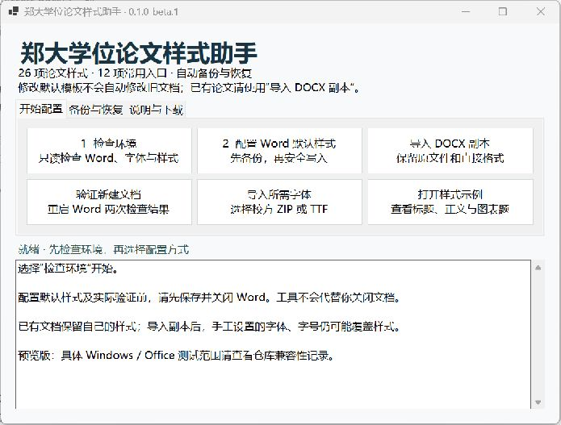

# 使用指南

## 先选择用途

如果只希望写论文时使用这套样式，下载仅模板包并从 DOTX 创建文档即可。如果希望以后从 Word 新建的空白文档都使用这套样式，再运行助手配置默认模板。已有 DOCX 则使用副本导入功能。

| 你准备做什么 | 入口 | 结果 |
|---|---|---|
| 看看当前电脑是否准备好 | 环境检查 | 读取 Word、字体和候选模板状态 |
| 以后新建都使用论文样式 | 配置默认样式 | 备份并修改 Word 实际默认模板 |
| 只为一篇论文使用 | 独立模板 | 从 DOTX 创建一个新文档 |
| 给旧论文加入样式 | 导入 DOCX 副本 | 原文件旁生成一个新 DOCX |
| 补齐封面楷体 | 字体导入 | 核验本地 ZIP / TTF 后按当前用户安装 |
| 确认重启后仍生效 | Word 实际验证 | 创建并检查自己的测试文档 |
| 回到以前的默认样式 | 恢复备份 | 核对当前文件后恢复所选备份 |

## 配置默认样式

先保存工作并关闭所有 Word 窗口。助手不会替你保存或强行结束 Word。点击配置入口后，程序查询 Word 的实际 Normal 模板位置；首次启动 Word 可能先初始化默认模板，这一步属于安装过程。

助手会读取当前模板、生成备份和候选文件，检查样式映射与其他内容是否保持，再写入结果。相同配置重复安装不会反复改写。遇到文件占用、其他程序同时修改模板或无法明确判断的样式冲突，安装会停止并说明原因。

完成后，重新打开 Word，通过“空白文档”或 `Ctrl+N` 新建。顶部常用样式库应显示 12 个项目；正常输入中英文时，正文使用宋体 / Times New Roman。可以通过 Word 实际验证检查两次独立启动后的结果。

其他模板新建的文档由各自模板控制。资源管理器右键“新建 Word 文档”是另一个入口，其适用状态见兼容性记录。

## 给已有 DOCX 导入样式

选择一个已保存的 DOCX。程序在同一目录生成 `原文件名_郑大样式.docx`；如果该名字已存在，继续使用带编号的新名字。导入不会覆盖原件。

这一步改变的是样式定义。原段落如果已使用相应的正文或标题样式，会继承新定义；如果段落使用自己创建的样式，或直接设置过字号、字体、缩进，显示可能仍有差异。请查看导入报告，在新副本里逐段应用对应样式。确认满意前保留原件。

首版入口只接收 DOCX，不将 DOC、DOCM、加密文档或带包级签名的文档静默转换。复杂文档建议先用少量页面检查目录、公式、图片和题注，再继续编辑副本。

## 补齐字体

字体检查是按样式用途显示结果。缺少字体时，即使样式已安装，Word 仍可能临时替代显示；这不能作为排版验收通过的依据。

需要封面旧版 `楷体_GB2312` 时，打开助手给出的校方页面，手动完成下载与验证码，再选择本地 ZIP / TTF。程序按内部名称、版本和已知 SHA-256 核验，不仅凭文件名判断。已存在的现代“楷体”保留，系统全局字体替代项也保留。

只有需要该字体的封面样式受其缺失影响。其余样式仍可检查和配置，但请在最终排版前补齐所有实际使用的字体。

## 恢复

先保存文档并关闭 Word，再选择助手中的备份恢复入口。若当前默认模板仍与安装后记录一致，可以恢复所选备份。若已经变化，先查看提示并保留当前版本的备份，再明确选择是否恢复，避免丢失后续新增设置。

恢复默认模板不撤销已经保存到各 DOCX 中的样式；已有 DOCX 的原件由副本导入流程保留。字体安装与模板恢复是两件独立操作，恢复模板不会卸载其他文档可能正在使用的字体。
